# Bitácora de Desarrollo Web — actividades y evidencias

**Estudiante:** María José Girón Tol  
**Carné:** 1090-23-15450  
**Curso:** Desarrollo Web  
**Fecha de entrega:** 8 de noviembre de 2026  
**Trabajo práctico desarrollado:** actividades 05 a 10; verificación local de Node.js (11); programación de rutas (12), `fetch` (13), SQLite (14), commits locales de Git (15), preparación de publicación (16) y cuestionario frontend 7/7 (17).  
**Material de estudio:** preguntas y respuestas de las actividades 01 a 20 de la guía.


Esta bitácora contiene las preguntas de la guía y sus respuestas, junto con prácticas de HTML, CSS y JavaScript. Las evidencias de las actividades trabajadas están en la carpeta [`evidencias/`](evidencias/), con notas sobre el alcance de cada prueba. Las demostraciones de Flexbox Froggy y el ejercicio de W3Schools son pruebas locales del código, no capturas de un envío realizado en esas plataformas. El proyecto incluye la ruta `POST` del servidor (Actividad 12) y el envío mediante `fetch` (Actividad 13). Las pruebas de navegador de la Actividad 13 usan respuestas simuladas; aún queda comprobar los endpoints ejecutando Express instalado en el equipo.

## HTML
- **Resumen propio (2–3 frases):** HTML define la estructura y el significado de una página. En el proyecto organiza el formulario de inscripción y sus campos.
- **Dos términos clave y su explicación:** `label`: identifica un campo para la persona usuaria; `required`: indica que debe completarse antes de enviar.
- **Ejemplo de código explicado:** `<label for="correo">Correo</label><input id="correo" name="correo" type="email" required>`: la etiqueta está asociada al campo, que exige un correo.
- **Pregunta que podría aparecer en el examen:** ¿Cómo se conecta un `label` con un campo? **Respuesta:** usando `for` en la etiqueta y el mismo `id` en el control.

## CSS
- **Resumen propio (2–3 frases):** CSS controla colores, tamaños y distribución de la página. También permite adaptarla a diferentes pantallas.
- **Dos términos clave y su explicación:** `padding`: espacio interno de un elemento; `margin`: separación exterior respecto a otros elementos.
- **Ejemplo de código explicado:** `.tarjeta { padding: 16px; margin: 12px; }` agrega espacio dentro de la tarjeta y alrededor de ella.
- **Pregunta que podría aparecer en el examen:** ¿Cómo se selecciona una clase `tarjeta`? **Respuesta:** con `.tarjeta`.

## JavaScript y DOM
- **Resumen propio (2–3 frases):** JavaScript hace interactiva la página. Mediante el DOM puede leer campos del formulario, escuchar eventos y mostrar los registros sin recargar.
- **Dos términos clave y su explicación:** `addEventListener`: escucha eventos; `preventDefault()`: impide el comportamiento automático de un evento.
- **Ejemplo de código explicado:** `formulario.addEventListener("submit", (evento) => evento.preventDefault());` escucha el envío y evita la recarga de la página.
- **Pregunta que podría aparecer en el examen:** ¿Para qué sirve `preventDefault()`? **Respuesta:** para controlar el envío con JavaScript sin que se recargue automáticamente.

## Node.js, Express y API
- **Resumen propio (2–3 frases):** Node.js permite ejecutar JavaScript en el servidor y Express facilita la creación de rutas HTTP. Una API comunica la página con el servidor mediante solicitudes y respuestas.
- **Dos términos clave y su explicación:** `GET`: consulta recursos; `POST`: envía datos para crear un recurso.
- **Ejemplo de ruta o solicitud explicado:** `GET /api/inscripciones` solicita la lista. `POST /api/inscripciones` envía una inscripción y, si se crea correctamente, debe responder con 201.
- **Pregunta que podría aparecer en el examen:** ¿Para qué sirve `express.json()`? **Respuesta:** para interpretar el cuerpo JSON recibido y acceder a `req.body`.

## SQL
- **Resumen propio (2–3 frases):** SQL sirve para trabajar con bases de datos relacionales. Permite definir tablas y consultar, agregar, modificar o eliminar registros.
- **Explica SELECT, INSERT, UPDATE y DELETE:** `SELECT` consulta; `INSERT` agrega; `UPDATE` modifica; `DELETE` elimina filas según una condición.
- **¿Qué son una clave primaria y una clave foránea?** La clave primaria (PK) identifica cada fila. La clave foránea (FK) hace referencia a la clave de otra tabla para relacionarlas.
- **Pregunta que podría aparecer en el examen:** ¿Qué sentencia consulta una tabla? **Respuesta:** `SELECT`.

## Git y GitHub
- **Resumen propio (2–3 frases):** Git registra versiones del código y ayuda a controlar cambios. GitHub permite alojar y compartir esos repositorios en línea.
- **Explica add, commit y push:** `git add` prepara los archivos; `git commit` registra una versión local; `git push` envía los commits al repositorio remoto.
- **Diferencia entre Git y GitHub:** Git es la herramienta de control de versiones; GitHub es una plataforma donde pueden alojarse repositorios Git.
- **Pregunta que podría aparecer en el examen:** ¿Cuál es el orden para publicar cambios? **Respuesta:** `git add` → `git commit` → `git push`.

---

# Preguntas de la guía interactiva (20 actividades)

Estas preguntas y consignas se obtuvieron del archivo **Redes .html**, cuyo contenido es **Desarrollo Web · Repaso interactivo**. Se mantienen en el orden de la guía para que puedas responderlas durante la clase.

**Cómo leer esta parte:** cada pregunta tiene su respuesta correcta debajo. Las tareas prácticas se distinguen como **Consignas / evidencias**; se incluyen explicaciones de apoyo, pero debes realizar las pruebas en tu computadora.


## Actividad 01 — Inicio

**Consignas / evidencias de esta actividad:**

- Preparar la carpeta base y abrir `bitacora.md`. Esta pantalla no presenta preguntas.

**Preguntas de la guía:** No se incluye una pregunta textual en esta actividad.


**Explicación y apoyo de la actividad:** La guía indica extraer el ZIP, abrir la carpeta en VS Code y mantener la bitácora para registrar las preguntas y respuestas. No hay una pregunta evaluativa en esta pantalla.

## Actividad 02 — Ruta y bitácora

**Consignas / evidencias de esta actividad:**

- En cada tema: resumen de 2–3 frases, dos términos clave, un ejemplo explicado y una pregunta de examen redactada con tus palabras.

**Preguntas de la guía:** No se incluye una pregunta textual en esta actividad.


**Explicación y apoyo de la actividad:** En cada tema se registra un resumen breve, dos términos clave, un ejemplo explicado y una posible pregunta de examen. La guía propone un recorrido de seis horas.

## Actividad 03 — Flujo web

**Consignas / evidencias de esta actividad:**

- Para las preguntas 3–6, imagina que Ana llena el formulario y presiona **Registrar**.

**Preguntas para responder:**

**1. ¿Qué significa frontend?**

**Respuesta:** Es la parte de la aplicación que ve y utiliza la persona en el navegador. HTML crea la estructura, CSS le da estilo y JavaScript permite la interacción.

**2. ¿Qué significa backend?**

**Respuesta:** Es la parte que se ejecuta en el servidor. Recibe solicitudes, revisa los datos y devuelve respuestas; también puede consultar o guardar información.

**3. ¿Qué presenta los campos?**

**Respuesta:** HTML presenta los campos del formulario.

**4. ¿Qué evita que el navegador recargue la página?**

**Respuesta:** JavaScript escucha el evento `submit` y usa `evento.preventDefault()` para evitar el envío y la recarga automáticos.

**5. ¿Qué componente recibe el JSON?**

**Respuesta:** El servidor, mediante una ruta de Express, recibe el JSON. `express.json()` permite leerlo desde `req.body`.

**6. ¿Qué parte puede guardar el registro?**

**Respuesta:** Una base de datos podría guardar el registro permanentemente. En este proyecto, el servidor guarda las inscripciones temporalmente en un arreglo.

**7. ¿Por qué Express vuelve a validar los datos?**

**Respuesta:** **Opción correcta: B.** Porque los datos que llegan desde el navegador pueden ser cambiados o manipulados; Express debe validarlos otra vez para proteger la aplicación.

**8. ¿Por qué conviene validar un correo también en el servidor, aunque el formulario use `type="email"`?**

**Respuesta:** Porque `type="email"` solo ayuda a validar en el navegador y esa comprobación se puede omitir. El servidor debe verificar el correo antes de aceptar el registro.


## Actividad 04 — HTML guiado

**Consignas / evidencias de esta actividad:**

- Explica qué hacen los atributos `name`, `type` y `required`.
- Escribe dos etiquetas semánticas y explica para qué sirven.

**Preguntas para responder:**

**1. ¿Qué conecta un `label` con su campo?**

**Respuesta:** **Opción correcta: B.** El atributo `for` del `<label>` debe coincidir con el `id` del campo correspondiente.


**Explicación y apoyo de la actividad:** `name` identifica el dato enviado; `type` indica qué clase de entrada se espera; `required` marca un campo como obligatorio. Ejemplos de etiquetas semánticas: `<header>` presenta una cabecera y `<main>` contiene la parte principal de la página.


**Video · HTML desde cero (minutos 10:52–15:22) — dos etiquetas semánticas y para qué sirven:**

1. **`<header>` (encabezado):** Representa la cabecera de una página o sección. Puede contener el título y la información introductoria. En el proyecto contiene «Registro al taller».
2. **`<main>` (contenido principal):** Identifica el contenido central de la página. En el proyecto agrupa el formulario y la lista de participantes.

*Estas dos etiquetas están en `public/index.html` y sirven para responder la consigna de la guía. No es necesario que el video cargue para localizarlas en el proyecto.*

**Comprueba antes de continuar — respuestas:**

1. **El archivo tiene una estructura HTML completa.** **Respuesta:** Sí. El archivo base `public/index.html` incluye `<!doctype html>`, `<html>`, `<head>` y `<body>`, además del contenido dentro de `<main>`.
2. **Cada campo tiene etiqueta visible y un `name`.** **Respuesta:** Sí, los campos que ya existen (nombre, correo y taller) tienen un `<label>` asociado mediante `for` e `id`, además de su atributo `name`. **En la Actividad 05 se agregaron** teléfono y horario con sus etiquetas y atributos, como se aprecia en el archivo actualizado.
3. **Puedo explicar la diferencia entre un elemento y un atributo.** **Respuesta:** Un **elemento HTML** forma parte de la estructura de la página, como `<input>` o `<header>`. Un **atributo** aporta información o define una característica del elemento, como `name="correo"`, `type="email"` o `required`.


## Actividad 05 — Práctica HTML

**Consignas / evidencias de esta actividad:**

- Abrí `public/index.html` y conservé los campos nombre, correo y taller.
- Agregué el campo **Teléfono** con `label`, `id="telefono"`, `name="telefono"`, `type="tel"` y `required`.
- Agregué el campo **Horario** con `label`, `id="horario"`, `name="horario"`, `select` y `required`.
- Asocié las etiquetas con sus campos utilizando `for` e `id` iguales. Los cinco controles tienen `name` y validación obligatoria.
- Agregué **datos ficticios de ejemplo** en el formulario para realizar las pruebas; estos datos no son personales ni registros reales.

**Datos ficticios utilizados en la práctica:**

| Campo | Dato ficticio |
| --- | --- |
| Nombre completo | Ana López (ejemplo) |
| Correo electrónico | ana.lopez@example.com |
| Teléfono | 5550-0123 |
| Taller | HTML y CSS |
| Horario | Sábado de 9:00 a 11:00 |

**Preguntas para responder:**

**1. ¿Qué información ya aparece en el HTML y qué falta para guardar el registro?**

**Respuesta:** El HTML tenía nombre, correo y taller. Agregué teléfono y horario. Para registrar una inscripción de verdad todavía se necesita programar el envío con JavaScript (`fetch`) y completar la ruta `POST` del servidor con Express.

**2. ¿Cuándo usarías `type="email"` y cuándo `type="tel"`?**

**Respuesta:** `type="email"` se utiliza para correos electrónicos y comprueba su formato básico; `type="tel"` se utiliza para números telefónicos y facilita escribirlos desde un teléfono.

**3. ¿Qué atributo indica que un campo es obligatorio?**

**Respuesta:** **Opción C: `required`.** Evita que se envíe un formulario si un campo obligatorio está vacío.

**4. ¿Qué sucede al dejar vacío un campo obligatorio y presionar Registrar inscripción?**

**Respuesta:** El navegador bloquea el envío y solicita que se complete el campo; así funciona la validación HTML. Para comprobarlo, primero hay que borrar uno de los valores ficticios precargados.

**5. ¿Por qué se debe relacionar `label for` con `input id` o `select id`?**

**Respuesta:** Porque así el nombre del campo queda vinculado a su control, lo que facilita el uso del formulario y mejora la accesibilidad.

**Evidencias del formulario:**

- 
- 

**Nota:** Las capturas corresponden a la etapa HTML. Los datos están escritos en el formulario como ejemplos; **la API aún no los almacena**, porque el código del servidor y de JavaScript se completa en las actividades posteriores.

## Actividad 06 — CSS y modelo de caja

**Consignas / evidencias de esta actividad:**

- Abrí `public/styles.css` y localicé el selector `.panel`, que da estilo a las dos secciones con borde (formulario y participantes inscritos).
- Cambié el borde de `.panel` a `2px solid #087e83` para destacarlo visualmente en verde azulado.
- Aumenté `padding` de `1.25rem` a `1.75rem` para ampliar el espacio **dentro** de los paneles.
- Aumenté `margin` de `1rem 0` a `1.5rem 0` para separar los paneles de otros elementos, y añadí `margin-top: 1rem` al formulario.
- Guardé el CSS y preparé imágenes de la página antes y después para comparar los cambios.

**Preguntas para responder:**

**1. ¿Qué selector aplica una regla a los elementos con `class="tarjeta"`?**

**Respuesta:** **Opción correcta: A.** `.tarjeta`, porque el punto (`.`) selecciona elementos por su clase. El numeral (`#`) selecciona un `id`.

**2. ¿Qué diferencia hay entre `padding` y `margin`?**

**Respuesta:** `padding` es el espacio **dentro** del borde de un elemento. `margin` es el espacio **fuera** del borde, que lo separa de otros elementos.

**3. ¿Qué cambió al actualizar el navegador?**

**Respuesta:** Los paneles se ven con un borde verde azulado más grueso. El texto y los controles quedan más separados del borde gracias al `padding`, y los paneles tienen mayor separación exterior por el `margin`.

**4. ¿Qué son el selector, la propiedad y el valor en CSS?**

**Respuesta:** El **selector** indica a qué elementos se aplica una regla; la **propiedad** dice qué aspecto se modifica, y el **valor** determina cómo. Ejemplo: en `.panel { border: 2px solid #087e83; }`, `.panel` es el selector, `border` es la propiedad y `2px solid #087e83` es el valor.

**5. Escribe una regla CSS propia y explica qué elemento selecciona.**

**Respuesta:** La regla que apliqué fue:

```css
.panel {
  margin: 1.5rem 0;
  border: 2px solid #087e83;
  padding: 1.75rem;
}
```

Selecciona todos los elementos con la clase `panel`. En este proyecto corresponde al bloque del formulario y al bloque de participantes inscritos.

**Referencia del video de la actividad:** La guía indica ver el segmento **2:09:22–2:18:10** del video de CSS e identificar selector, propiedad y valor. La identificación anterior se realizó con el código del proyecto; no se afirma haber reproducido el video.

**Evidencias de la actividad 06:**

- 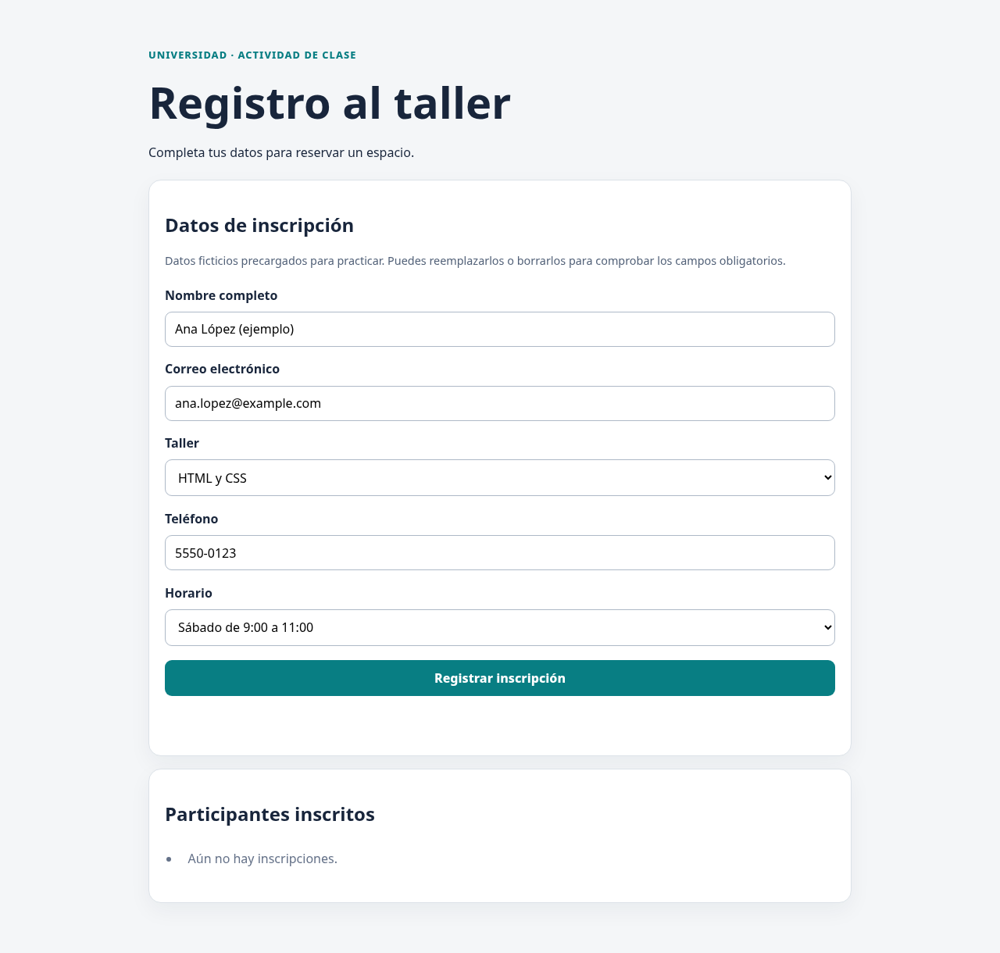
- 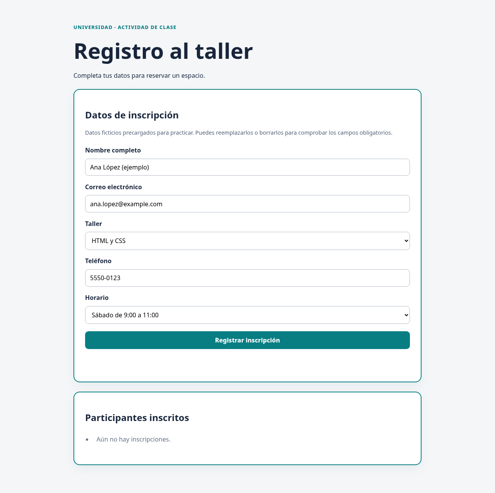

**Resultado:** El formulario conserva los datos ficticios y los cinco campos de la Actividad 05. Los cambios de esta actividad son solo de presentación; no se modificó el envío con JavaScript ni la API. El ejercicio de adaptación a pantallas móviles queda para la Actividad 07.

## Actividad 07 — Responsive y Flexbox Froggy

**Consignas / evidencias de esta actividad:**

- La pregunta anterior se refiere a `@media (max-width: 640px)`.
- Registra una propiedad de Flexbox y una regla de media query, y explica qué cambio visual produce cada una.

**Preguntas para responder:**

**1. ¿Cuándo se aplica la regla de este ejemplo?**

**Respuesta:** **Opción correcta: B.** La regla `@media (max-width: 640px)` se aplica cuando el ancho de la pantalla o ventana es de 640 píxeles o menos.


**Explicación y apoyo de la actividad:** En Flexbox, `justify-content: center` centra elementos en el eje principal y `align-items: center` en el eje transversal. Un `@media (max-width: 640px)` puede cambiar dos columnas a una para pantallas angostas.

### Práctica: ocho niveles de Flexbox Froggy

La guía solicita **resolver al menos los primeros 8 niveles** del juego. A continuación se documentan las soluciones correctas y su explicación. **Las capturas adjuntas de estos niveles son demostraciones locales del CSS, no capturas de una partida realizada en la web oficial.** Cuando se jueguen los niveles en el sitio original, pueden añadirse las capturas reales a esta carpeta.

| Nivel | Código CSS para `#pond` | ¿Para qué sirve? | Evidencia local |
|---|---|---|---|
| 1 | `justify-content: flex-end;` | Sitúa la rana en el extremo derecho del eje principal. | [Ver captura](evidencias/actividad_07_nivel_01_demostracion_local.png) |
| 2 | `justify-content: center;` | Centra las ranas horizontalmente. | [Ver captura](evidencias/actividad_07_nivel_02_demostracion_local.png) |
| 3 | `justify-content: space-around;` | Reparte espacio alrededor de cada rana. | [Ver captura](evidencias/actividad_07_nivel_03_demostracion_local.png) |
| 4 | `justify-content: space-between;` | Distribuye las ranas con espacio entre ellas. | [Ver captura](evidencias/actividad_07_nivel_04_demostracion_local.png) |
| 5 | `align-items: flex-end;` | Coloca la rana abajo, en el eje transversal. | [Ver captura](evidencias/actividad_07_nivel_05_demostracion_local.png) |
| 6 | `justify-content: center; align-items: center;` | Centra la rana tanto horizontal como verticalmente. | [Ver captura](evidencias/actividad_07_nivel_06_demostracion_local.png) |
| 7 | `justify-content: space-around; align-items: flex-end;` | Separa las ranas horizontalmente y las baja. | [Ver captura](evidencias/actividad_07_nivel_07_demostracion_local.png) |
| 8 | `flex-direction: row-reverse;` | Invierte la dirección horizontal: de derecha a izquierda. | [Ver captura](evidencias/actividad_07_nivel_08_demostracion_local.png) |


**Ejemplo de CSS utilizado en el nivel 7:**

```css
#pond {
  display: flex;
  justify-content: space-around;
  align-items: flex-end;
}
```

**¿Qué propiedades aprendí?**

- `justify-content`: organiza los elementos a lo largo del eje principal (normalmente horizontal cuando `flex-direction: row`). Por ejemplo, `space-around` deja espacio alrededor de las ranas.
- `align-items`: alinea los elementos en el eje transversal (normalmente vertical). Por ejemplo, `flex-end` mueve las ranas hacia la parte inferior.
- `flex-direction`: define la dirección del eje principal. `row-reverse` invierte el orden horizontal.

### Aplicación de Flexbox y diseño responsive en el formulario

**Regla Flexbox que agregué a `public/styles.css`:**

```css
.contenedor {
  display: flex;
  flex-wrap: wrap;
  align-items: flex-start;
  gap: 1.25rem;
}
.panel { flex: 1 1 360px; min-width: 0; }
```

**¿Qué selecciona y qué cambia?** `.contenedor` organiza los paneles de inscripción y participantes en paralelo cuando hay espacio; `flex-wrap` permite que pasen a otra fila cuando el ancho es menor. `gap` separa los paneles sin alterar el contenido.

**Regla media query que agregué:**

```css
@media (max-width: 640px) {
  .contenedor {
    width: calc(100% - 1rem);
    padding: 1rem 0;
    flex-direction: column;
  }
  .panel { width: 100%; padding: 1.15rem; }
}
```

**¿Cuándo se aplica y qué cambio visual produce?** Se activa en pantallas de 640 px de ancho o menos. El formulario y la lista se muestran uno debajo del otro, con menos espacio exterior e interior, para leerse mejor en un teléfono.

**Comprueba antes de continuar:**

1. **Puedo distinguir `padding` y `margin`.** Sí: `padding` es espacio **dentro** del borde; `margin`, **fuera** del borde.
2. **Puedo explicar cuándo se activa un media query.** Sí: en este ejercicio, cuando el ancho es de **640 px o menos**.
3. **Probé el proyecto en ancho normal y angosto.** Se hicieron pruebas locales en navegador con vista de computadora y teléfono; las capturas muestran ambos resultados.

**Evidencia del proyecto (capturas reales de la página local):**

- [Vista de computadora: paneles lado a lado](evidencias/actividad_07_formulario_escritorio.png)
- [Vista de teléfono: paneles en una columna](evidencias/actividad_07_formulario_movil.png)

**Evidencia de la práctica de Flexbox (demostraciones locales):**

- [Montaje de soluciones CSS de los ocho niveles](evidencias/actividad_07_resumen_ocho_niveles.png)
- [Página HTML local de práctica, con niveles 1–8](evidencias/practica_flexbox_niveles_01_a_08.html)

**Pendiente solamente si la docente exige capturas del juego original:** entrar en https://flexboxfroggy.com/#es, ingresar las soluciones, avanzar hasta el nivel 9 y tomar capturas que muestren la pantalla del juego; sustituir las demostraciones locales por esas capturas. No se presenta una simulación como progreso del juego.


### Evidencia adicional — vista móvil 412 × 968 y revisión del HTML

**Actividad realizada:** comprobé el formulario a un tamaño de pantalla de **412 × 968 píxeles**, como se mostró durante la clase, revisando en el HTML el campo Teléfono y el selector Horario.

**¿Qué observé?** El diseño responsive se activa porque 412 px es menor que 640 px. Los paneles se colocan uno debajo del otro y los campos siguen siendo legibles. Los elementos tienen etiquetas asociadas con `for` e `id`.

**¿Qué comprobé en el código?** El control de teléfono usa `type="tel"` y `required`; el selector de horario también tiene `required`. El documento no presenta desbordamiento horizontal a 412 px.

**Capturas de evidencia:**

- [Captura real de la vista móvil de 412 × 968](evidencias/actividad_07_prueba_responsive_412x968.png).
- [Montaje: vista móvil más extracto del HTML del proyecto](evidencias/actividad_07_evidencia_vista_movil_y_html.png).

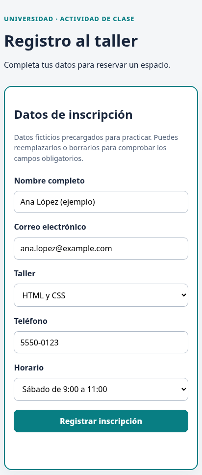

**Nota:** la segunda imagen muestra la captura real de la página junto con su código HTML para facilitar la explicación. Es un montaje de evidencias, **no** una captura nativa de las herramientas de desarrollo de Chrome. No se cambió la funcionalidad del servidor.

## Actividad 08 — JavaScript base

**Video de apoyo:** [Aprende JavaScript — Curso Completo desde Cero (freeCodeCamp Español)](https://www.youtube.com/watch?v=ivdTnPl1ND0&t=483s). Segmento indicado por la guía: **08:03 a 17:46** (variables y asignación). La guía también pide **predecir el resultado de una suma** antes de ejecutarla: para ese punto se elaboró el ejemplo práctico de abajo. En el índice del video, la sección específica de suma empieza en **26:36**; por eso el ejercicio de suma siguiente es **propio**, no una transcripción del fragmento asignado.

### Resumen del contenido y conceptos

- Una **variable** almacena un valor que el programa puede utilizar.
- La instrucción `=` **asigna** un valor a una variable. No significa “igualdad matemática”.
- `const` declara una variable a la que no se puede asignar un nuevo valor. Es útil para datos que no deben reasignarse, como el límite de cupos.
- `let` permite reasignar su valor. Es útil para un contador de inscripciones.
- El operador `+` suma dos números. Se puede calcular la respuesta antes de ejecutar y luego verificar el resultado en la consola.

### Actividad del video — Predecir el resultado de una suma

**Pregunta: ¿Qué mostrará `console.log(suma)` antes de ejecutar el siguiente código?**

```javascript
const numero1 = 7;
const numero2 = 5;
const suma = numero1 + numero2;
console.log(suma);
```

**Mi predicción:** `12`.

**Resultado comprobado:** `12`.

**Explicación:** `numero1` guarda 7 y `numero2` guarda 5. El operador `+` suma ambos valores: `7 + 5 = 12`. El resultado se almacena en `suma` y `console.log` lo muestra.

### Explica — ¿En qué caso usaría `const` y en cuál `let`?

**Ejemplo con `const`:**

```javascript
const cuposMaximos = 20;
```

Usaría `const` porque el número máximo de cupos del taller se mantiene fijo durante este ejemplo.

**Ejemplo con `let`:**

```javascript
let inscritos = 0;
inscritos++;
console.log(inscritos); // 1
```

Usaría `let` porque la cantidad de inscritos aumenta cada vez que se registra una persona.

### Cuestionario y reto de lectura

**1. Después de ejecutar el bloque original de la guía una vez, ¿cuánto vale `inscritos`?**

**Respuesta:** **Opción C: 1.** Empieza en 0 y la función `hayCupo()` devuelve `true`, de manera que se ejecuta `inscritos++` una sola vez.

**2. Si cambias `inscritos` a 20, ¿se ejecutará `inscritos++`?**

**Respuesta:** **No.** La condición `20 < 20` es falsa, por lo que el bloque `if` no se ejecuta y `inscritos` sigue valiendo 20.

**3. Con `inscritos = 20`, ¿qué valor devuelve `hayCupo()`?**

**Respuesta:** Devuelve **`false`**, porque no quedan cupos disponibles.

**4. ¿Qué diferencia hay entre `const` y `let`?**

**Respuesta:** Con `const` no se puede reasignar la variable. Con `let`, sí es posible asignarle otro valor.

**5. ¿Para qué sirven `+`, `=` y `++`?**

**Respuesta:** `+` suma, `=` asigna un valor y `++` aumenta una variable numérica en 1.

### Comprobación y evidencias

Se ejecutó una **práctica propia de JavaScript** con Node.js para comprobar la suma y el comportamiento del contador; no se alteró el formulario ni el servidor.

- Código ejecutable: [`evidencias/actividad_08_variables_y_suma.js`](evidencias/actividad_08_variables_y_suma.js).
- Registro real de ejecución: [`evidencias/actividad_08_resultado_node.txt`](evidencias/actividad_08_resultado_node.txt).
- Captura de práctica local en navegador: [`evidencias/actividad_08_practica_js.png`](evidencias/actividad_08_practica_js.png).

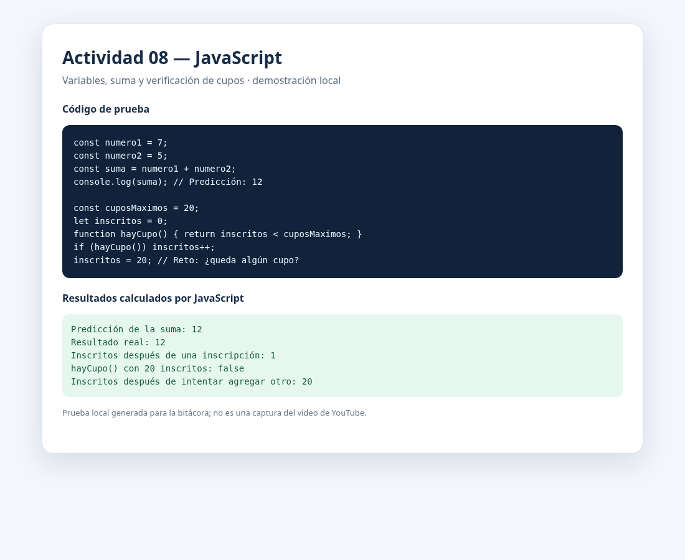

> **Nota sobre la evidencia:** es una captura de la práctica local que ejecuta JavaScript, **no** una captura del video de YouTube ni de una clase en directo. Los ejemplos se elaboraron para cumplir la consigna de la guía.

## Actividad 09 — DOM y eventos

**Objetivo:** conectar el formulario con acciones del usuario mediante el DOM y practicar los eventos `submit`, `click` e `input`.

### Resumen propio (2–3 frases)

El DOM representa el contenido HTML de una página y permite que JavaScript encuentre y cambie sus elementos. Con `addEventListener` puedo ejecutar una función al pulsar un botón, escribir en un campo o enviar un formulario. Con `preventDefault()` impido que el envío normal recargue la página.

### Dos términos clave y explicación

- **`querySelector`:** localiza un elemento HTML utilizando un selector CSS, por ejemplo `#formulario-registro`.
- **`addEventListener`:** ejecuta una función cuando ocurre un evento; por ejemplo, `submit`, `click` o `input`.

### Preguntas de la guía con respuestas

**1. ¿Para qué usamos `preventDefault()`?**

**Respuesta:** Para evitar que el navegador realice la acción predeterminada de un evento, como enviar un formulario y recargar la página. Así JavaScript puede procesar sus campos.

**2. ¿Qué instrucción permite escuchar el envío del formulario?**

**Respuesta:** **Opción A: `formulario.addEventListener("submit", ...)`**.

**3. ¿Qué hace `querySelector()`?**

**Respuesta:** Encuentra el primer elemento HTML que coincide con el selector; por ejemplo, `document.querySelector("#formulario-registro")` busca el formulario por su `id`.

**4. ¿Qué hace `addEventListener()`?**

**Respuesta:** Permite asociar una función a un evento de un elemento de la página.

**5. ¿Qué sucede al usar `click` en el botón de práctica?**

**Respuesta:** Cada clic incrementa el contador en uno y cambia el texto que se muestra, sin actualizar la página.

**6. ¿Qué sucede cuando escribo en el campo Nombre completo?**

**Respuesta:** Se produce el evento `input`, y JavaScript actualiza un mensaje con el texto escrito.

**7. ¿Para qué sirve `FormData(formulario)`?**

**Respuesta:** Para leer los valores de los controles del formulario usando su atributo `name`. Por ejemplo, `datos.get("nombre")` obtiene el nombre.

### Práctica realizada en `public/app.js`

**Paso 1:** identificar el formulario:

```javascript
const formulario = document.querySelector("#formulario-registro");
```

**Paso 2:** escuchar el evento `submit` y evitar la recarga:

```javascript
formulario.addEventListener("submit", (evento) => {
  evento.preventDefault();
  const datos = new FormData(formulario);
  console.log("Actividad 09 — Nombre del formulario:", datos.get("nombre"));
});
```

**Paso 3:** pulsar **Hacer clic**. Se usa el evento `click` para incrementar un contador. Por ejemplo, tras tres pulsaciones aparece **3**.

**Paso 4:** cambiar el texto del campo Nombre completo. El evento `input` permite mostrar el nombre mientras se escribe.

**Comprobación:** se verificó en una ejecución local que el evento `submit` leyó el nombre ficticio **Ana López (ejemplo)**, que el contador aumentó al hacer clic y que el formulario no produjo una navegación. Los resultados están documentados en la evidencia de prueba.

**Importante:** esta etapa todavía **no guarda inscripciones en el servidor**. El `POST` y `fetch` se completan en las actividades posteriores de la guía.

### Capturas y resultados de prueba

- [Captura del envío de formulario sin recargar](evidencias/actividad_09_submit_sin_recarga.png).
- [Captura de contador después de tres clics](evidencias/actividad_09_evento_click_contador.png).
- [Captura de respuesta al escribir en un campo](evidencias/actividad_09_evento_input.png).
- [Registro de pruebas del navegador](evidencias/actividad_09_resultados_pruebas.txt).

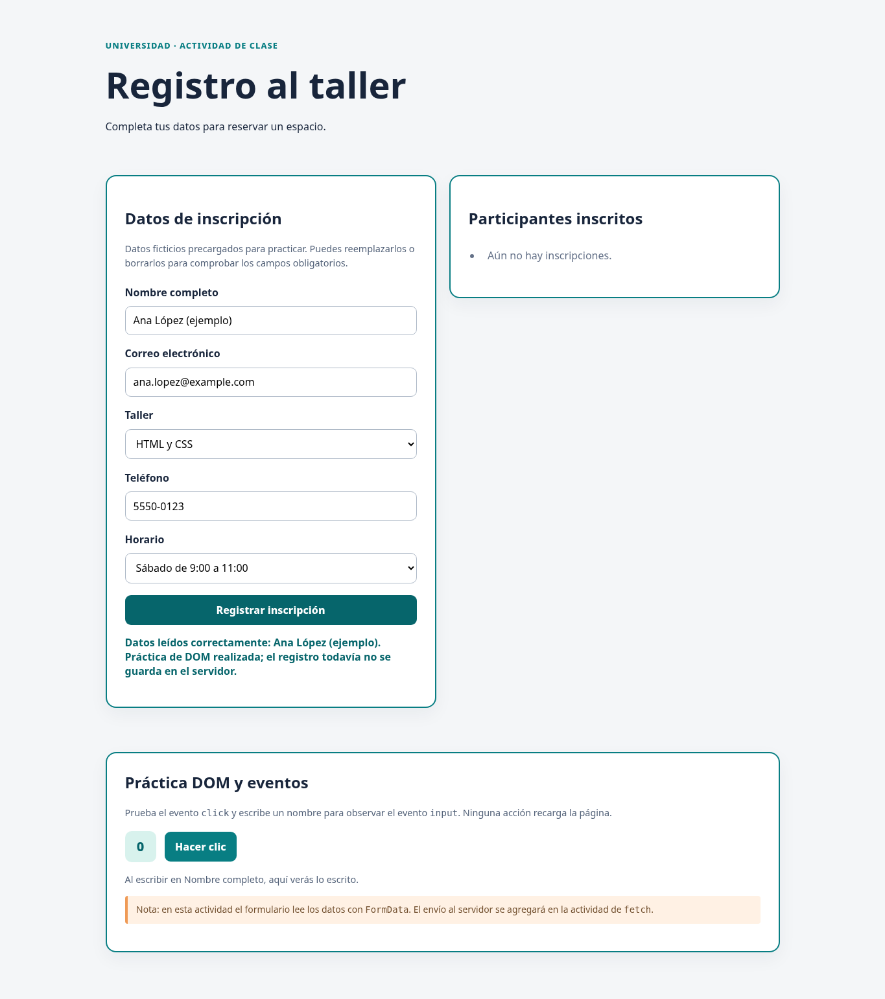

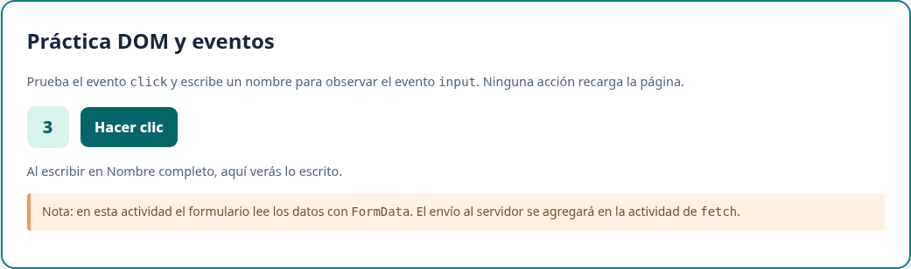

> Estas son capturas reales del **proyecto local**, no de la videollamada ni de la plataforma de repaso interactivo.

## Actividad 10 — Práctica JavaScript: arreglos y funciones

**Objetivo de la guía:** crear un arreglo `inscripciones` con tres nombres, escribir una función que cuente los elementos con `length` y presentar el resultado dentro de un párrafo HTML. La guía propone practicar en OneCompiler y CodePen y consultar los segmentos del video sobre arreglos (desde 1:45:24) y funciones (desde 2:18:41).

### Resumen propio (2–3 frases)

Un **arreglo** permite guardar varios valores ordenados en una sola variable. Una **función** agrupa instrucciones reutilizables y puede devolver un resultado con `return`. En este ejercicio usamos `length` para contar tres nombres y `textContent` para mostrar el total en la página.

### Dos términos clave

- **Arreglo (`array`):** estructura que reúne varios valores, por ejemplo `["Ana", "Luis", "Marta"]`.
- **`length`:** propiedad que devuelve la cantidad de elementos de un arreglo. En este caso devuelve `3`.

### Actividad del video: arreglos y funciones

**¿Qué es un arreglo?** Es una lista ordenada de datos que se puede recorrer o consultar por posición. Sus índices comienzan en cero.

**¿Qué es una función?** Es un bloque de código al que se le da un nombre para poder ejecutarlo cuando se necesite. Puede regresar un valor mediante `return`.

**¿Qué función cumple `length`?** Contar los elementos contenidos en un arreglo.

**Ejemplo explicado:** Si el arreglo contiene tres personas, `inscripciones.length` devuelve `3`. La función `contarInscripciones()` devuelve ese valor y JavaScript lo coloca en un párrafo HTML.

> Nota sobre el video: estas son explicaciones de los **temas indicados en la guía** y del código desarrollado; no se afirma haber reproducido la grabación en YouTube.

### Práctica solicitada y resultados

**Paso 1. Ejercicio corto de arreglos y funciones (equivalente local de OneCompiler).**

Se preparó el archivo [`evidencias/actividad_10_arreglos_y_funciones.js`](evidencias/actividad_10_arreglos_y_funciones.js) y se ejecutó con Node.js como práctica local. No se utilizó una cuenta de OneCompiler.

**Paso 2. Crear el arreglo `inscripciones` con tres nombres ficticios.**

```javascript
const inscripciones = ["Ana López", "Luis Pérez", "Marta García"];
```

**Paso 3. Escribir la función que cuenta con `length`.**

```javascript
function contarInscripciones() {
  return inscripciones.length;
}
```

**Paso 4. Mostrar el resultado en un párrafo HTML.**

```html
<p id="resultado">Calculando...</p>
```

```javascript
document.querySelector("#resultado").textContent = "Total: " + contarInscripciones();
```

**Resultado obtenido:** `Total: 3`. En el proyecto principal se usa el nombre `inscripcionesEjemplo` para que los tres nombres de práctica no se confundan con los registros del servidor.

**Demostración equivalente local de CodePen:** [`evidencias/actividad_10_practica_tipo_codepen.html`](evidencias/actividad_10_practica_tipo_codepen.html). Es un archivo HTML independiente que permite comprobar el resultado en el navegador, pero no constituye una ejecución en el sitio web CodePen.

### Preguntas y respuestas para la bitácora

**1. ¿Para qué sirve un arreglo en JavaScript?**

**Respuesta:** Para almacenar varios valores en una sola variable y acceder a ellos por su posición.

**2. ¿Qué devuelve `inscripciones.length` si el arreglo tiene tres nombres?**

**Respuesta:** Devuelve el número `3`.

**3. ¿Qué hace `return` en una función?**

**Respuesta:** Devuelve un valor al lugar desde donde se llamó a la función.

**4. ¿Para qué utilizamos `document.querySelector()`?**

**Respuesta:** Para localizar un elemento de la página mediante un selector CSS, como `#resultado`.

**5. ¿Para qué sirve `textContent`?**

**Respuesta:** Para leer o cambiar el contenido de texto de un elemento HTML.

**6. ¿Cómo se conecta la función con el párrafo HTML?**

**Respuesta:** JavaScript llama a `contarInscripciones()` y asigna el valor devuelto a `textContent` del párrafo.

**7. ¿Qué diferencia hay entre un arreglo y una función?**

**Respuesta:** El arreglo almacena datos y la función ejecuta instrucciones para procesarlos.

**8. ¿Qué pasaría si agregamos otro nombre al arreglo?**

**Respuesta:** `length` devolvería `4` y el párrafo mostraría cuatro inscripciones de ejemplo.

**Pregunta posible de examen:** ¿Cómo se obtiene la cantidad de inscritos de un arreglo y cómo se presenta en HTML?

**Respuesta:** Se usa la propiedad `.length` dentro de una función y después se coloca el resultado en el elemento HTML con `textContent`.

### Evidencias de la Actividad 10

- [Captura de la aplicación con los tres nombres y el resultado](evidencias/actividad_10_formulario_y_resultado.png).
- [Captura de código y resultado de la práctica HTML local](evidencias/actividad_10_codigo_y_resultado.png).
- [Salida de la ejecución JavaScript con Node.js](evidencias/actividad_10_salida_node.txt).

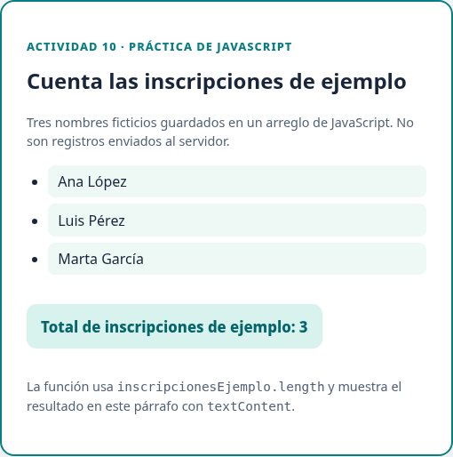

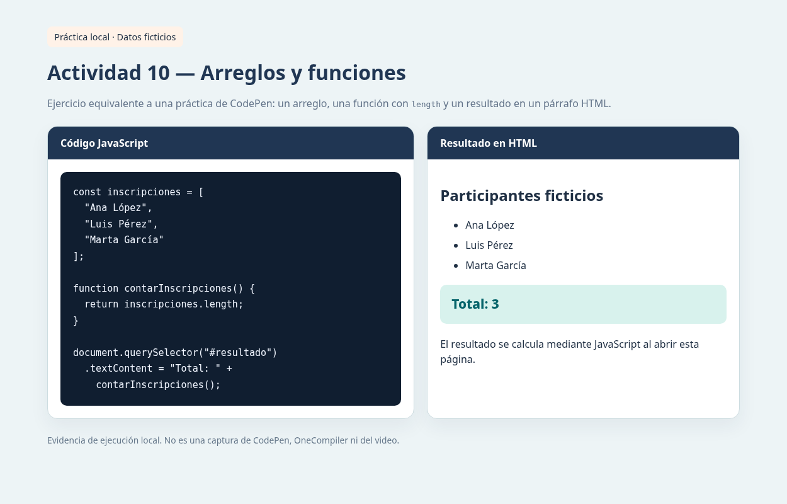

**Comprobación:** El arreglo contiene tres nombres de ejemplo, la función devuelve `3` y el párrafo HTML muestra el resultado correctamente. Los inscritos de ejemplo no se guardan en el servidor; la ruta POST se programó en la Actividad 12 y `fetch` se implementó en la Actividad 13; la conexión real con Express sigue pendiente de comprobar.

### Ejercicio seleccionado en W3Schools — JS Array Methods (práctica adicional)

**Sitio de consulta:** [W3Schools — Ejercicio sobre métodos de arreglos](https://www.w3schools.com/js/exercise.asp?x=xrcise_array_methods1).

**Pregunta:** Después de ejecutar el siguiente código, ¿cómo queda el arreglo `fruits`?

```javascript
const fruits = ["Banana", "Orange", "Apple"];
fruits.pop();
```

**Respuesta correcta:** `['Banana', 'Orange']`.

**Explicación:** El método `pop()` elimina el último elemento de un arreglo. Como `Apple` estaba al final, quedan `Banana` y `Orange`, y `fruits.length` pasa a valer `2`.

**¿Qué hice para comprobarlo?** Ejecuté un archivo JavaScript local con Node.js y obtuve:

```text
Resultado: ["Banana","Orange"]
Cantidad de elementos: 2
```

**Evidencia y archivos:**

- [Captura de la resolución y el resultado de la práctica local](evidencias/actividad_10_w3schools_ejercicio_local.png).
- [Código JavaScript ejecutado](evidencias/actividad_10_w3schools_array_pop.js).
- [Salida comprobada de Node.js](evidencias/actividad_10_w3schools_resultado_node.txt).
- [Página HTML de demostración local](evidencias/actividad_10_w3schools_practica_local.html).

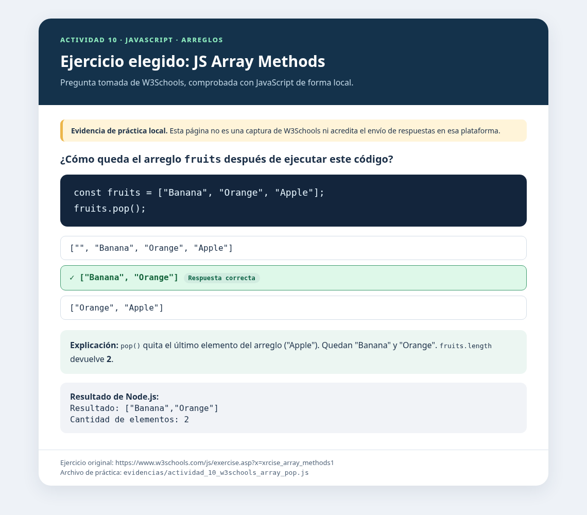

> **Aclaración:** Se seleccionó una pregunta real publicada por W3Schools y se verificó su respuesta mediante código local. Esta imagen **no** es una captura del ejercicio enviado en W3Schools ni prueba de progreso en una cuenta de esa plataforma.


### Cierre de la Actividad 10 — Entrega completa (actualización)

**Consigna de la guía:** «Resuelve, ejecuta y explica tu código». Se eligió **W3Schools** para el ejercicio corto de arreglos y se realizó una demostración local equivalente a **CodePen** para mostrar HTML, CSS y JavaScript funcionando juntos. La guía pide un ejercicio en OneCompiler **o** W3Schools; no se requiere hacer ambos sitios.

**A. Ejercicio de W3Schools elegido:** quitar el último elemento del arreglo con `pop()`.

```javascript
const fruits = ["Banana", "Orange", "Apple"];
fruits.pop(); // Elimina "Apple".
// Queda: ["Banana", "Orange"]
```

**Resultado comprobado:** quedan dos frutas, `Banana` y `Orange`. La comprobación fue local con Node.js, sin envío a W3Schools.

**B. Ejercicio de tres inscripciones para CodePen:**

```javascript
const inscripciones = ["Ana López", "Luis Pérez", "Marta García"];
function contarInscripciones() {
  return inscripciones.length;
}
// contarInscripciones() devuelve 3.
```

**Código HTML para el resultado:** `<p id="inscripciones-total"></p>`.

**Código que conecta la función con la página:**

```javascript
document.querySelector("#inscripciones-total").textContent =
  `Total de inscripciones: ${contarInscripciones()}`;
```

**Resultado comprobado en navegador:** **Total de inscripciones: 3**. También se mostraron los tres nombres dentro de una lista HTML y se comprobó la vista móvil.

**¿Qué aprendí de arreglos y funciones?** El arreglo reúne datos en una variable; `.length` cuenta sus elementos y la función devuelve ese número utilizando `return`. Con `querySelector()` y `textContent` se puede presentar la información en la página.

**Registro asociado al video:** La guía remite al tema de arreglos desde **1:45:24** y al tema de funciones desde **2:18:41**. La explicación anterior corresponde a los conceptos aplicados en la práctica; no se afirma haber visto o reproducido esos fragmentos.

**Archivos para entregar o pegar en CodePen:**

- [HTML para CodePen](evidencias/actividad_10_codepen_HTML.html)
- [CSS para CodePen](evidencias/actividad_10_codepen_CSS.css)
- [JavaScript para CodePen](evidencias/actividad_10_codepen_JavaScript.js)
- [Ejercicio listo para abrir localmente](evidencias/actividad_10_practica_completa_abrir.html)
- [Instrucciones y explicación de evidencias](evidencias/LEEME_actividad_10_entrega.md)

**Capturas tomadas de la ejecución real del código en un navegador local:**

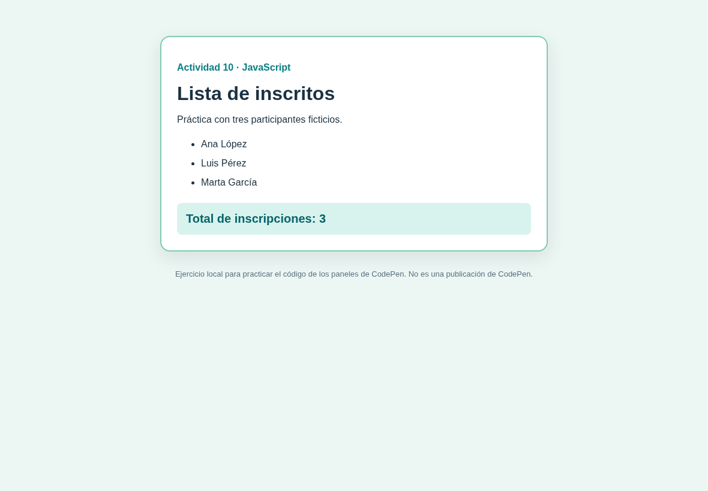

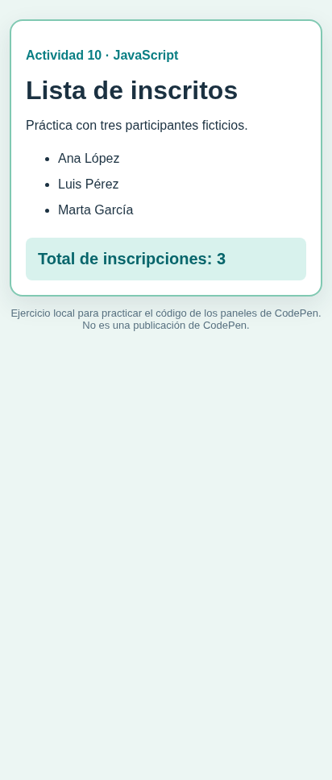


**Comprobación técnica:** [Resultado de las pruebas](evidencias/actividad_10_comprobacion_ejecutada.txt).

**Estado de entrega:** código, explicaciones y capturas locales preparados. Si se exige evidencia de trabajo dentro de una cuenta de **W3Schools/CodePen**, hay que pegar allí el código y tomar la captura desde ese sitio; estas imágenes no se presentan como capturas de sus plataformas.

## Actividad 11 — Node.js y VS Code

**Objetivo:** verificar la instalación de Node.js y npm, comprender las herramientas y ejecutar el proyecto desde la terminal.

### Preguntas de la actividad

**1. ¿Qué diferencia hay entre Node.js, npm y VS Code?**

**Respuesta:** Node.js permite ejecutar JavaScript fuera del navegador, por ejemplo en un servidor. npm sirve para instalar y administrar los paquetes o dependencias que necesita un proyecto. Visual Studio Code es un editor de código donde podemos crear y modificar los archivos.

**2. ¿Por qué aparece la carpeta `node_modules` después de la instalación y por qué no se debe subir a GitHub?**

**Respuesta:** Cuando se ejecuta `npm install`, npm descarga las dependencias del proyecto y las guarda en `node_modules`. No se debe subir esa carpeta a GitHub porque suele ocupar mucho espacio y puede generarse de nuevo con `npm install`; por eso se coloca en `.gitignore`.

**3. ¿Qué hace `npm install` y qué inicia `npm start`?**

**Respuesta:** `npm install` instala las dependencias definidas en `package.json`. `npm start` ejecuta el script `start` del archivo `package.json`; en nuestro proyecto inicia el servidor con `node server.js`.

### Pasos y comprobación

1. Abrir la carpeta `registro-taller-estudiante` en Visual Studio Code y abrir **Terminal → New Terminal**.
2. Escribir `node -v` y `npm -v`: si Node.js y npm están disponibles, la terminal muestra sus números de versión.
3. Ejecutar `npm install` desde la carpeta que contiene `package.json`.
4. Ejecutar `npm start` y visitar `http://localhost:3000` para verificar el funcionamiento de la página.
5. Para detener el servidor, presionar `Ctrl + C`.

**Comprobación realizada en un entorno de prueba:** `node -v` respondió **v22.16.0** y `npm -v` respondió **10.9.2**. También se comprobó con `node --check server.js` que el archivo del servidor no presenta errores de sintaxis. **Esta comprobación no acredita la instalación en mi computadora personal**; para entregar esa evidencia debo tomar una captura de mi propia terminal.

**Estado de la práctica:** las preguntas están respondidas y existe una evidencia real de ejecución de los comandos en un entorno de prueba. La instalación de dependencias con `npm install` no finalizó aquí y no se ha verificado la apertura de `localhost:3000` en el equipo personal.

### Comprueba antes de continuar

- **¿Qué debe aparecer cuando escribo `node -v`?** Una versión de Node.js, por ejemplo `v22.16.0` en el entorno de prueba.
- **¿Qué debe suceder al abrir `localhost:3000` después de ejecutar `npm start`?** Debe mostrarse la página del proyecto, siempre que las dependencias se hayan instalado correctamente y el servidor haya iniciado.
- **¿Puedo explicar la diferencia entre `npm install` y `npm start`?** Sí. `npm install` instala los paquetes y `npm start` ejecuta la aplicación según el script configurado.

### Captura de evidencia local

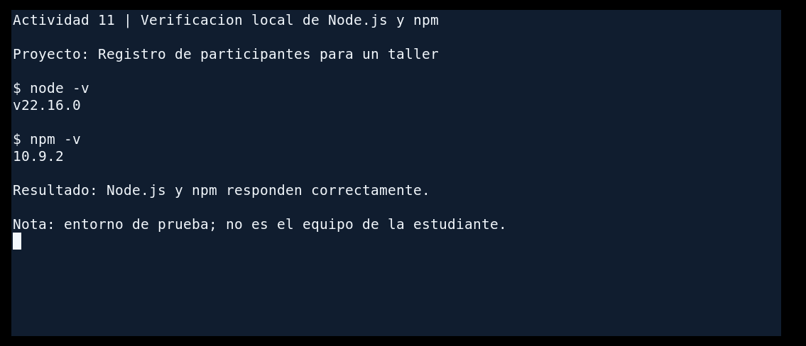

**Nota:** esta imagen corresponde al entorno de prueba, no a una captura del equipo personal de la estudiante. Para verificar mi computadora, debo abrir su terminal, ejecutar `node -v` y `npm -v` y guardar una captura real.

## Actividad 12 — API con Express

**Estudiante:** María José Girón Tol  
**Carné:** 1090-23-15450

### 1. ¿Qué es una ruta en Express?

**Respuesta:** Es una dirección de la API asociada a un método HTTP y a una función que atiende la solicitud del usuario. En Express, `app.get()` permite consultar información y `app.post()` permite recibir información para crear un registro.

### 2. Escribe un ejemplo de GET y otro de POST.

**GET:** `GET /api/inscripciones` devuelve un arreglo JSON con las inscripciones. Cuando aún no hay datos, la respuesta es `[]` con estado `200`.

**POST:** `POST /api/inscripciones` recibe un JSON con `nombre`, `correo`, `telefono`, `taller` y `horario`, valida su contenido y guarda un registro temporal. Cuando todo está correcto, responde `201` y devuelve el objeto con un `id`.

### 3. ¿Cuándo se utilizan los estados HTTP 200, 201 y 400?

- **200 (OK):** cuando una consulta GET se realiza correctamente.
- **201 (Created):** cuando un POST crea satisfactoriamente una inscripción.
- **400 (Bad Request):** cuando falta información o el correo electrónico tiene formato inválido.

### 4. ¿Para qué sirve `express.json()`?

**Respuesta correcta: opción B.** Sirve para interpretar el JSON enviado al servidor en el cuerpo de la solicitud y leer sus valores desde `req.body`. No guarda información en una base de datos.

### 5. ¿Qué hace `express.static("public")`?

**Respuesta:** Permite que Express entregue archivos públicos como `index.html`, `styles.css` y `app.js` al navegador.

### 6. ¿Cómo se define una ruta y cómo se devuelve una respuesta?

**Respuesta:** La estructura `app.get("/ruta", (req, res) => {...})` relaciona el método y la ruta con una función. `req` contiene información de la solicitud y `res` permite enviar la respuesta. Se utiliza `res.json(datos)` para enviar JSON y `res.status(201).json(registro)` para indicar una creación exitosa.

### Práctica realizada en `server.js`

1. Se revisó la ruta existente `GET /api/inscripciones`: responde `200` y devuelve la lista temporal, inicialmente `[]`.
2. Se completó `POST /api/inscripciones` leyendo los cinco datos desde `req.body`.
3. Se comprobó que los cinco valores fueran textos no vacíos y que el correo tuviera un formato básico válido.
4. Si algún dato es inválido, la ruta devuelve `400` y un mensaje; si está correcto, genera un `id`, guarda el registro en el arreglo temporal y devuelve `201`.
5. Los registros se guardan **solo en memoria**. Al reiniciar el servidor, la lista vuelve a estar vacía.

**Ejemplo de petición válida:**

```json
{
  "nombre": "Ana López",
  "correo": "ana.lopez@example.com",
  "telefono": "5550-0123",
  "taller": "HTML y CSS",
  "horario": "Sábado de 9:00 a 11:00"
}
```

**Resultado de prueba de los controladores:** GET inicial → `200` y `[]`; POST válido → `201` y registro con `id: 1`; GET después de POST → `200` y lista con un registro; POST con teléfono vacío → `400`; POST con correo incorrecto → `400`.

**Evidencia y alcance de la comprobación:** Se ejecutaron **7 pruebas** con `node --test pruebas/actividad_12.test.js`. Como no se pudieron descargar las dependencias de npm en este entorno, se simularon las funciones externas de Express para probar los controladores reales de `server.js`. **Esto no sustituye una prueba HTTP real** desde `http://localhost:3000`, que debe comprobarse al instalar Express en una computadora con acceso a npm.

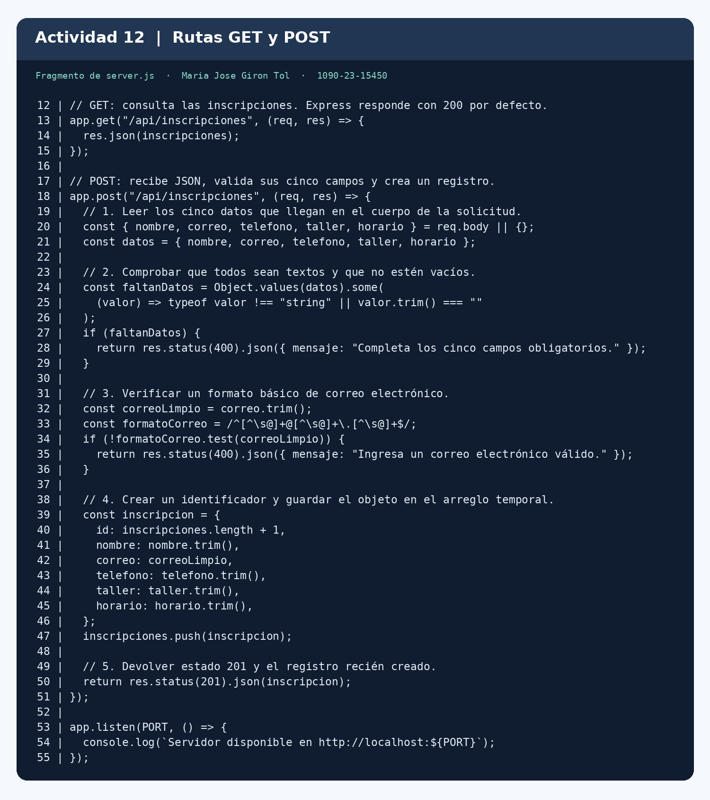

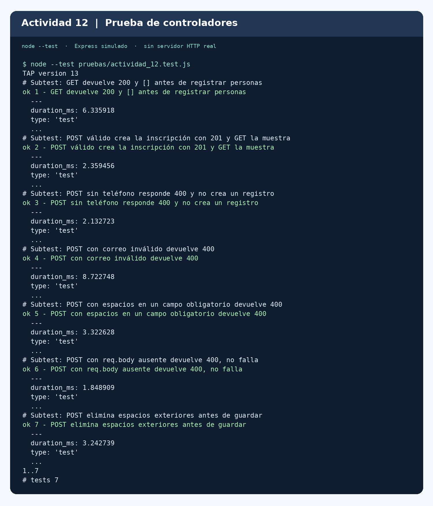

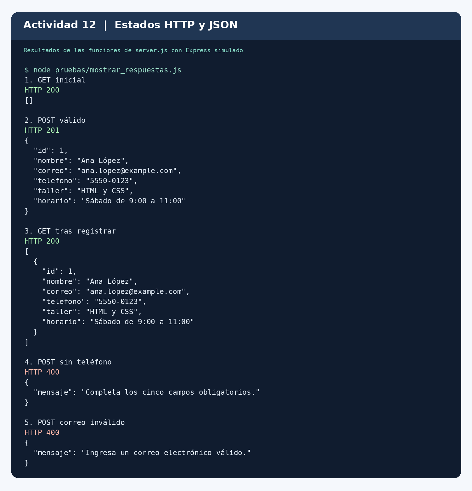

**Archivos de prueba:** [`actividad_12_pruebas_controladores.txt`](evidencias/actividad_12_pruebas_controladores.txt) y [`actividad_12_ejemplos_respuestas.txt`](evidencias/actividad_12_ejemplos_respuestas.txt).

### Comprueba antes de continuar

- **¿Qué devuelve GET si aún no se registró nadie?** Un arreglo vacío `[]` con respuesta `200`.
- **¿Qué ocurre si POST recibe un correo inválido?** Responde `400` y un mensaje de error; no guarda la inscripción.
- **¿Qué ocurre al enviar los cinco datos correctos?** Crea un registro temporal, lo agrega al arreglo y responde `201`.

## Actividad 13 — `fetch` y JSON

**Consignas / evidencias de esta actividad:**

- Explica la diferencia entre `JSON.stringify()` y `response.json()`.

**Preguntas para responder:**

**1. ¿Por qué se usa `JSON.stringify(datos)`?**

**Respuesta:** **Opción correcta: C.** `JSON.stringify(datos)` convierte un objeto de JavaScript en texto JSON para enviarlo en la solicitud HTTP.

**2. ¿Qué representa el estado 201?**

**Respuesta:** El estado HTTP **201 (Created)** indica que el servidor creó correctamente un recurso, como una nueva inscripción.


**Explicación y apoyo de la actividad:** `JSON.stringify(datos)` convierte un objeto en una cadena JSON antes de enviarlo. `response.json()` interpreta el JSON que llega en la respuesta y lo transforma en un valor JavaScript.

### Práctica con datos ficticios y capturas

**Datos utilizados en la simulación de la guía (Actividad 13):**

| Campo | Dato ficticio |
|---|---|
| Nombre | Sofía López |
| Correo | sofia.lopez@example.com |
| Teléfono | 5555 1234 |
| Taller | JavaScript |
| Horario | Mañana |

**Procedimiento:** completé los cinco controles y presioné **Simular envío**. La guía generó un objeto `requestBody` con esos datos y mostró una **respuesta simulada HTTP 201** con el mensaje `Inscripción creada (simulación local)`. La guía indica que esta demostración **no envía información a un servidor**.

**Solicitud que usaría el proyecto al conectarse:** `POST /api/inscripciones`, encabezado `Content-Type: application/json` y cuerpo `JSON.stringify(datos)`.

**Comprobación del proyecto:** completé `public/app.js` para consultar la lista con `GET /api/inscripciones` y enviar los cinco campos por `fetch` a `POST /api/inscripciones`. Tras una respuesta correcta, actualiza la lista de personas con `textContent`. La captura del formulario conectado utiliza respuestas simuladas dentro del navegador, no una solicitud real ejecutada contra Express.

**Respuesta a la pregunta:** el estado **201 Created** indica que la solicitud de creación fue aceptada y que el servidor creó el recurso. En la guía se usa como demostración, no como comprobación del servidor.

**Evidencias:**

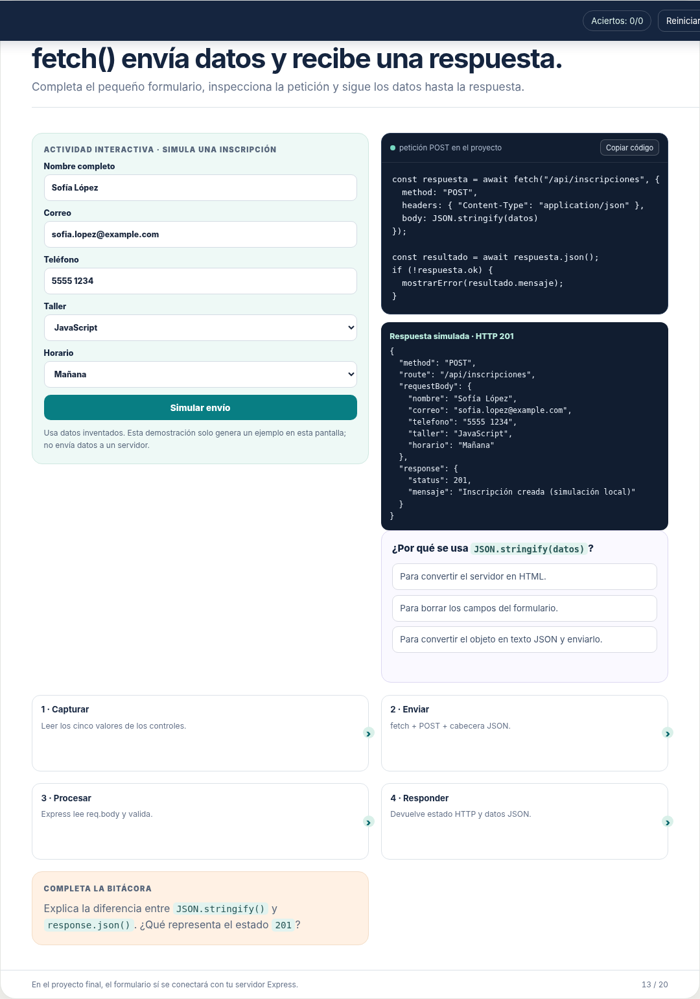

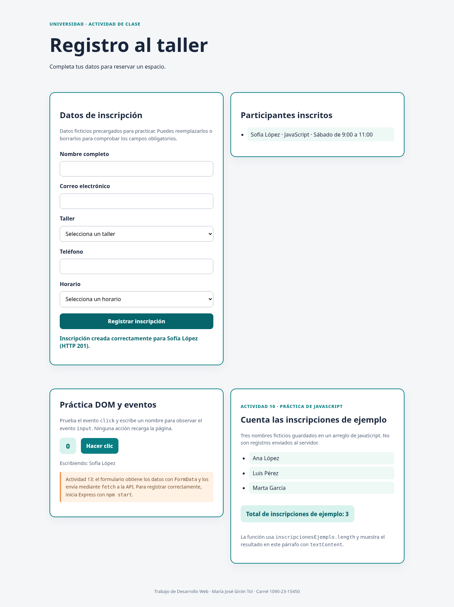

**Pendiente para una comprobación real:** ejecutar `npm install`, `npm start`, abrir `http://localhost:3000`, registrar un ejemplo nuevo y confirmar que `GET /api/inscripciones` muestra el registro. La lista se conserva solo mientras el servidor está encendido.

## Actividad 14 — SQL

**Consignas / evidencias de esta actividad:**

- Define DDL y DML e incluye un ejemplo de cada uno.
- Explica `SELECT`, `INSERT`, `UPDATE` y `DELETE`.
- ¿Qué son una clave primaria y una clave foránea?

**Preguntas para responder:**

**1. ¿Qué sentencia consulta registros?**

**Respuesta:** **Opción correcta: A.** La sentencia `SELECT` se utiliza para consultar registros de una tabla.

**2. Después de ejecutar `DELETE` y volver a consultar, ¿qué fila desapareció?**

**Respuesta:** En el ejemplo de la guía desaparece la fila de `talleres` con `id = 1` (el taller **Desarrollo Web**), porque se ejecuta `DELETE FROM talleres WHERE id = 1;`.


**Explicación y apoyo de la actividad:** **DDL** define la estructura de la base de datos, por ejemplo `CREATE TABLE`. **DML** manipula registros, por ejemplo `INSERT`, `UPDATE` y `DELETE`; `SELECT` consulta datos. **Clave primaria (PK):** identifica cada fila sin repetirse. **Clave foránea (FK):** relaciona una fila con otra tabla.


### Práctica ejecutada: SQLite — tabla `talleres`

**¿Qué se hizo en la pantalla de SQLite Fiddle?** Primero se creó la tabla con `CREATE TABLE`; luego se insertó un taller ficticio con `INSERT`. La consulta `SELECT` mostró el registro, `UPDATE` cambió el horario y `DELETE` lo eliminó. Por último, se volvió a ejecutar `SELECT` y la tabla quedó sin registros.

**Datos ficticios utilizados:** nombre **Desarrollo Web**, horario inicial **Tarde**, horario actualizado **Noche**, id **1**. En el ejemplo de la guía se usa `Mañana` para el cambio; aquí utilicé `Noche` para seguir la demostración de clase.

| Paso | SQL | Resultado comprobado |
|---|---|---|
| 1. Crear tabla | `CREATE TABLE talleres (...)` | Se creó la estructura con `id`, `nombre` y `horario`. |
| 2. Insertar | `INSERT INTO talleres ...` | Se guardó `1 / Desarrollo Web / Tarde`. |
| 3. Consultar | `SELECT id, nombre, horario FROM talleres;` | Apareció una fila. |
| 4. Actualizar | `UPDATE talleres SET horario = 'Noche' WHERE id = 1;` | Cambió `Tarde` por `Noche`. |
| 5. Consultar | `SELECT ... FROM talleres;` | Se observó `1 / Desarrollo Web / Noche`. |
| 6. Eliminar | `DELETE FROM talleres WHERE id = 1;` | Se eliminó el taller con id 1. |
| 7. Comprobar | `SELECT ... FROM talleres;` | Se devolvieron **0 filas**. |

**¿Cuál era el error mostrado en la captura de clase?** Se escribió `SELECT * talleres;` y SQLite marcó error de sintaxis. La instrucción correcta es `SELECT * FROM talleres;` porque `FROM` indica qué tabla consultar.

**¿Qué significa DDL?** Lenguaje de definición de datos. Se utiliza para crear o modificar estructuras; por ejemplo, `CREATE TABLE`.

**¿Qué significa DML?** Lenguaje de manipulación de datos. Permite insertar, actualizar y eliminar registros con `INSERT`, `UPDATE` y `DELETE`. `SELECT` se utiliza para consultar; también puede clasificarse como DQL.

**¿Qué función cumple `WHERE id = 1`?** Limita `UPDATE` y `DELETE` al registro indicado. Si se omite `WHERE`, se pueden modificar o eliminar todas las filas de la tabla.

**¿Qué son PK y FK?** `id INTEGER PRIMARY KEY` define una clave primaria única para cada taller. Una clave foránea (`FOREIGN KEY`) permite relacionar otra tabla, como `inscripciones`, con un taller a través de `taller_id`.

**Evidencias de la ejecución:** estas capturas y el registro son de una **práctica real ejecutada con SQLite local**. No son capturas del sitio SQLite Fiddle ni representan trabajo realizado directamente en ese sitio.

- 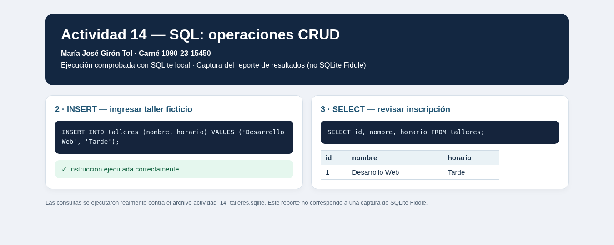
- 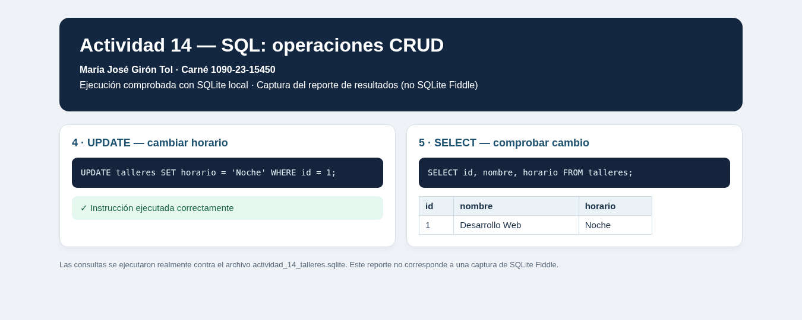
- 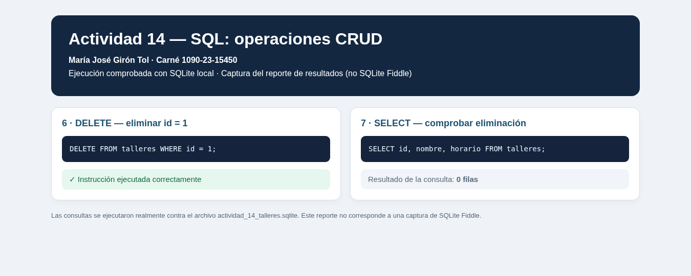
- 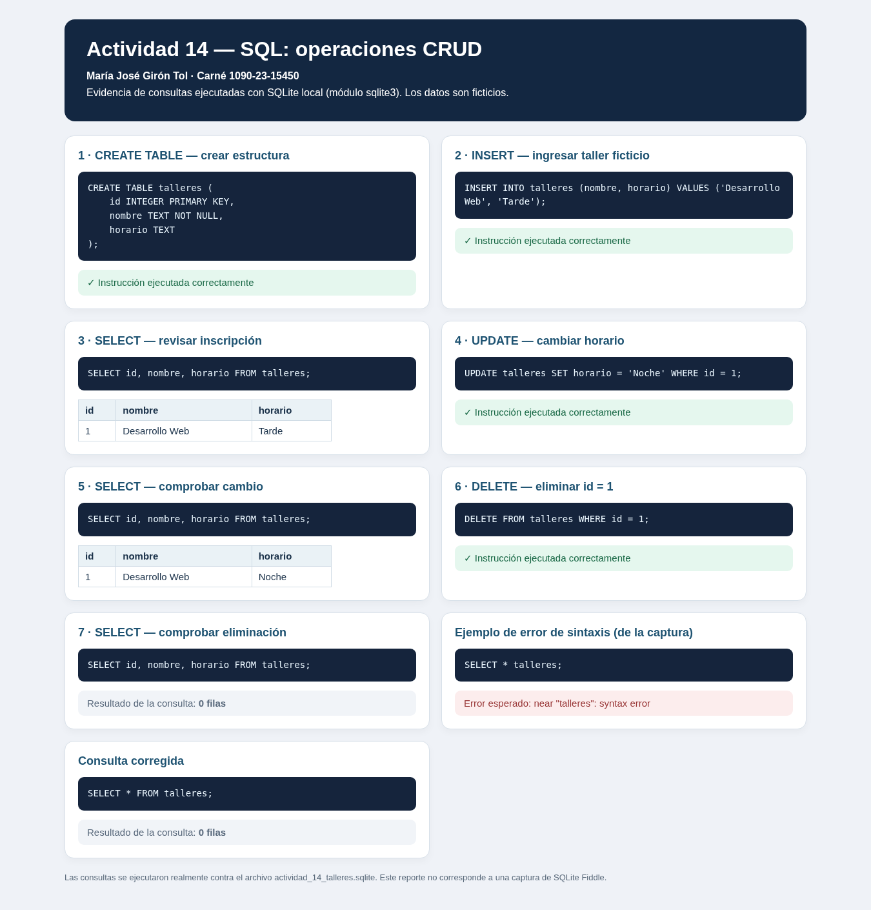
- Código SQL completo: [`evidencias/actividad_14_consultas.sql`](evidencias/actividad_14_consultas.sql).
- Ejecución registrada: [`evidencias/actividad_14_registro_ejecucion.txt`](evidencias/actividad_14_registro_ejecucion.txt).
- Base de datos de práctica: `evidencias/actividad_14_talleres.sqlite`.

## Actividad 15 — Git y control de versiones

**Estudiante:** María José Girón Tol  
**Carné:** 1090-23-15450  
**Fecha:** 8 de noviembre de 2026

### ¿Qué se realizó?

Se preparó un repositorio Git **local** del proyecto `registro-taller-estudiante`. Se guardaron versiones descriptivas de la estructura inicial, del formulario con CSS y de la programación con la documentación. Después se revisó el historial mediante `git log` y el estado de los archivos mediante `git status`. La publicación en GitHub está pendiente porque requiere configurar un repositorio remoto y autenticar la cuenta correspondiente.

### Preguntas y respuestas de la guía

**1. ¿Cuál es el orden correcto para guardar y publicar un cambio?**  
**Respuesta:** Opción **C: `git add` → `git commit` → `git push`**.

**2. ¿Qué diferencia hay entre `git add`, `git commit` y `git push`?**  
**Respuesta:** `git add` selecciona cambios para el próximo commit; `git commit` crea una versión de esos cambios en el repositorio local; `git push` envía los commits a un repositorio remoto, por ejemplo GitHub.

**3. ¿Qué información comunica un buen mensaje de commit?**  
**Respuesta:** Describe de manera breve y específica qué se modificó y para qué. Ejemplos: `Completa formulario HTML y estilos adaptables` e `Integra JavaScript, API y documentación de prácticas`.

**4. ¿Cuál es la diferencia entre Git y GitHub?**  
**Respuesta:** Git es la herramienta de control de versiones que funciona localmente; GitHub es una plataforma en línea para alojar y compartir repositorios Git.

**5. ¿Para qué sirven `git status` y `git log --oneline`?**  
**Respuesta:** `git status` muestra si hay archivos modificados o preparados; `git log --oneline` presenta el historial resumido de commits.

**6. ¿Qué archivos deben excluirse mediante `.gitignore`?**  
**Respuesta:** Al menos `node_modules/` y `.env`. El primero contiene dependencias que pueden reinstalarse y el segundo puede guardar configuraciones sensibles.

**7. ¿Por qué un commit no aparece automáticamente en GitHub?**  
**Respuesta:** Porque `git commit` guarda el cambio localmente; hace falta enlazar un repositorio remoto y ejecutar `git push`.

### Práctica realizada con Git

Comandos usados para revisar y versionar el proyecto:

```bash
git --version
git init -b main
git status
git add .
git commit -m "Agrega estructura inicial del proyecto"
git add .
git commit -m "Completa formulario HTML y estilos adaptables"
git add .
git commit -m "Integra JavaScript, API y documentación de prácticas"
git log --oneline
git check-ignore -v .env node_modules/archivo-ejemplo.js
```

**Comprobación:** Git registró las versiones locales; `.gitignore` excluye `.env` y `node_modules/`. En la evidencia se muestra la salida de los comandos ejecutados en el entorno de práctica. No se efectuó `git push` a GitHub.

**Capturas:**

- [Git: historial de versiones, `git status` y versión instalada](evidencias/actividad_15_git_historial_terminal.png).
- [Git: comprobación de `.gitignore` y trabajo local](evidencias/actividad_15_git_ignore_terminal.png).
- [Registro textual de los comandos y sus salidas](evidencias/actividad_15_registro_terminal.txt).

**Nota sobre la identidad de los commits:** para generar la práctica local se utilizó el nombre de la estudiante y un correo de ejemplo (`estudiante@example.invalid`), que **no es una dirección personal real**. Antes de publicar el repositorio, se debe configurar el correo correcto de Git.

**Pendiente en la cuenta personal:** crear el repositorio en GitHub (Actividad 16), conectar `origin` y subir la rama `main`. La evidencia de esta actividad demuestra los commits **locales**, no una publicación en GitHub.

## Actividad 16 — Crear cuenta y publicar en GitHub

**Instrucciones de la guía:** crear o iniciar sesión en GitHub, crear un repositorio vacío llamado `registro-taller-desarrollo-web`, conectar la carpeta local y verificar los archivos subidos.

**Pregunta: ¿Por qué no añades otro README al crear el repositorio?**  
**Respuesta correcta: opción A.** Porque en el proyecto local ya existe `README.md`, que describe cómo instalar y ejecutar la aplicación. Para enlazarlo sin conflictos conviene crear el repositorio remoto vacío.

**¿Qué se comprobó en la práctica?**  
En el proyecto local existe la rama `main`, se conservan cuatro commits anteriores y están `server.js`, `public/`, `README.md` y `bitacora.md`. También existe `.gitignore` con `node_modules/` y `.env`.

**¿Cómo se publica el proyecto?**  
Primero se crea en la cuenta personal un repositorio vacío y se copia su dirección HTTPS. Desde la carpeta del proyecto se ejecuta `git remote add origin URL_HTTPS_REAL_DEL_REPOSITORIO` (o `git remote set-url origin ...` si ya existiera) y `git push -u origin main`, después de configurar el correo propio y registrar los cambios pendientes.

**Diferencia entre lo realizado y lo pendiente:** la preparación y las comprobaciones de Git son reales y locales. No hay un repositorio remoto configurado ni enlace de entrega: **la publicación requiere entrar en la cuenta de GitHub y hacer el push**. No se simula haber completado ese paso.

**Evidencias:** [revisión visual local](evidencias/actividad_16_preparacion_publicacion_git.png), [registro de comprobaciones](evidencias/actividad_16_estado_local.txt) y [guía paso a paso de publicación](evidencias/actividad_16_publicar_en_github.md).

## Actividad 17 — Cuestionario frontend: HTML, CSS y JavaScript

**Resultado obtenido en la guía interactiva abierta localmente:** **7 respuestas correctas de 7 posibles (7/7)**. Las opciones se seleccionaron en el cuestionario real del HTML proporcionado para el repaso.

**1. ¿Qué tecnología define la estructura y el significado del contenido?**  
**Respuesta correcta: A. HTML.** Organiza y describe el contenido de una página.

**2. ¿Qué conecta una etiqueta `label` con su campo?**  
**Respuesta correcta: C. `for` en `label` y el mismo `id` en el control.** Permite asociar la etiqueta con el campo correspondiente.

**3. ¿Qué combinación marca un campo obligatorio que debe parecerse a un correo?**  
**Respuesta correcta: B. `type="email"` y `required`.** El tipo comprueba el formato básico y `required` impide dejarlo vacío.

**4. ¿Qué selector aplica a `class=tarjeta`?**  
**Respuesta correcta: A. `.tarjeta`.** El punto indica una clase en CSS.

**5. ¿Cuándo se activa `@media (max-width: 640px)`?**  
**Respuesta correcta: C. Cuando el ancho es de 640 píxeles o menos.** Permite adaptar el diseño a pantallas más estrechas.

**6. ¿Qué hace `addEventListener`?**  
**Respuesta correcta: B. Escucha un evento y ejecuta una función.** Por ejemplo, responde a un clic o al envío de un formulario.

**7. ¿Para qué se usa `preventDefault()` en el evento `submit`?**  
**Respuesta correcta: A. Evitar la recarga automática del navegador.** Permite manejar el envío desde JavaScript.

**Análisis del resultado:** no hubo respuestas incorrectas en esta práctica. Se repasaron las explicaciones de las siete preguntas para distinguir la estructura HTML, las reglas CSS y la interacción JavaScript.

**Capturas reales de la guía HTML ejecutada localmente:** [cuestionario con respuestas seleccionadas](evidencias/actividad_17_quiz_frontend_respuestas.png) y [resultado 7/7](evidencias/actividad_17_quiz_frontend_resultado.png). Estas capturas corresponden a la página de repaso proporcionada, no a la pantalla de una clase por videollamada.

## Actividad 18 — Cuestionario backend (8 preguntas)

**Preguntas para responder:**

**1. ¿Qué es Node.js?**

**Respuesta:** **Opción correcta: B.** Node.js es un entorno para ejecutar JavaScript fuera del navegador, incluido el servidor.

**2. ¿Qué hace `npm install`?**

**Respuesta:** **Opción correcta: C.** `npm install` instala las dependencias indicadas en el proyecto.

**3. ¿Qué método suele servir para consultar inscripciones?**

**Respuesta:** **Opción correcta: A, GET.** Se usa para consultar las inscripciones.

**4. ¿Qué permite hacer `express.json()`?**

**Respuesta:** **Opción correcta: B.** `express.json()` permite leer el cuerpo JSON recibido por el servidor.

**5. ¿Qué estado HTTP responde normalmente al crear una inscripción?**

**Respuesta:** **Opción correcta: C, 201.** Indica que se creó una inscripción.

**6. ¿Qué sentencia consulta filas de una tabla?**

**Respuesta:** **Opción correcta: A, SELECT.** Sirve para consultar filas.

**7. ¿Qué hace `git push`?**

**Respuesta:** **Opción correcta: B.** `git push` envía commits locales al repositorio remoto.

**8. ¿Cuál es la diferencia más precisa entre Git y GitHub?**

**Respuesta:** **Opción correcta: C.** Git registra versiones del código; GitHub aloja repositorios en línea.


**Explicación y apoyo de la actividad:** Las respuestas de las ocho preguntas están indicadas debajo de cada una. Según la guía, conviene repasar Node, Express, SQL y Git si se obtienen menos de seis aciertos.

## Actividad 19 — Proyecto final

**Consignas / evidencias de esta actividad:**

- No hay preguntas textuales de cuestionario en esta pantalla. Se pide completar un registro de participantes con nombre, correo, teléfono, taller y horario.
- Anota evidencias de las pruebas: registro válido, campo vacío, correo inválido, pantalla móvil, instrucciones README y repositorio GitHub.
- Verifica `GET /api/inscripciones` y `POST /api/inscripciones`; explica qué hacen las respuestas 201 y 400.

**Preguntas de la guía:** No se incluye una pregunta textual en esta actividad.


**Explicación y apoyo de la actividad:** La aplicación debe registrar **nombre, correo, teléfono, taller y horario**. `GET /api/inscripciones` devuelve la lista; `POST /api/inscripciones` valida y crea un registro (**201**), o devuelve error (**400**) si falta información o el correo no es válido. **Estado actual:** se documentaron la prueba de campo obligatorio (Actividad 05) y la vista móvil (Actividad 07). Las rutas GET/POST se programaron en la Actividad 12 y `fetch` en la Actividad 13; quedan pendientes las pruebas HTTP ejecutando Express instalado y la publicación en GitHub.

## Actividad 20 — Defensa y cierre

**Consignas / evidencias de esta actividad:**

- Practica una explicación de un minuto sobre el flujo formulario → JavaScript → fetch → Express → respuesta.

**Preguntas para responder:**

**1. ¿Qué función cumplen HTML, CSS y JavaScript en tu aplicación?**

**Respuesta:** HTML organiza el formulario y la lista de participantes; CSS mejora la presentación y adapta la página a diferentes tamaños; JavaScript lee los campos, responde a eventos y actualiza la pantalla.

**2. ¿Qué sucede desde que presionas Registrar hasta que ves la respuesta?**

**Respuesta:** Al pulsar **Registrar**, JavaScript detiene el envío normal, toma los datos y usa `fetch` para enviarlos como JSON. Express recibe y valida la solicitud; si es correcta, añade el registro al arreglo y responde con estado 201 y JSON. Luego JavaScript muestra el mensaje y actualiza la lista.

**3. ¿Qué diferencia hay entre GET y POST? ¿Qué rutas implementaste?**

**Respuesta:** `GET` consulta datos y `POST` envía datos para crear un registro. Las rutas del ejercicio son `GET /api/inscripciones` y `POST /api/inscripciones` (completada en la Actividad 12).

**4. ¿Por qué validas los datos en el navegador y también en Express?**

**Respuesta:** El navegador valida para orientar al usuario de inmediato; Express vuelve a validar porque los datos de la solicitud pueden modificarse y el servidor no debe confiar solo en el navegador.

**5. ¿Qué significa que el arreglo sea temporal? ¿Qué cambiaría con una base de datos SQL?**

**Respuesta:** Que el arreglo sea temporal significa que los registros se pierden cuando se reinicia el servidor. Con una base de datos SQL podrían mantenerse guardados después de reiniciar y consultarse más adelante.

**6. ¿Qué guarda un commit y para qué sirve push?**

**Respuesta:** Un `commit` registra una versión de los cambios dentro del historial local de Git. `git push` envía esos commits al repositorio remoto, por ejemplo, a GitHub.


**Explicación y apoyo de la actividad:** Explicación corta para la defensa: **HTML presenta el formulario → JavaScript recoge los datos → `fetch` los envía en JSON → Express valida y procesa → el servidor responde → JavaScript muestra el resultado.**


---

# Preguntas adicionales que indique el ingeniero

Utiliza este espacio para registrar **literalmente las preguntas que les dicten o asignen en clase**, aunque no aparezcan en las 20 actividades. Si te dan más preguntas, agrega nuevas entradas siguiendo el mismo formato.


**Pregunta del ingeniero 1:** _Escribe aquí la pregunta._

**Respuesta:** _Completar cuando el ingeniero indique esta pregunta._

**Pregunta del ingeniero 2:** _Escribe aquí la pregunta._

**Respuesta:** _Completar cuando el ingeniero indique esta pregunta._

**Pregunta del ingeniero 3:** _Escribe aquí la pregunta._

**Respuesta:** _Completar cuando el ingeniero indique esta pregunta._

**Pregunta del ingeniero 4:** _Escribe aquí la pregunta._

**Respuesta:** _Completar cuando el ingeniero indique esta pregunta._

**Pregunta del ingeniero 5:** _Escribe aquí la pregunta._

**Respuesta:** _Completar cuando el ingeniero indique esta pregunta._

**Pregunta del ingeniero 6:** _Escribe aquí la pregunta._

**Respuesta:** _Completar cuando el ingeniero indique esta pregunta._

**Pregunta del ingeniero 7:** _Escribe aquí la pregunta._

**Respuesta:** _Completar cuando el ingeniero indique esta pregunta._

**Pregunta del ingeniero 8:** _Escribe aquí la pregunta._

**Respuesta:** _Completar cuando el ingeniero indique esta pregunta._

**Pregunta del ingeniero 9:** _Escribe aquí la pregunta._

**Respuesta:** _Completar cuando el ingeniero indique esta pregunta._

**Pregunta del ingeniero 10:** _Escribe aquí la pregunta._

**Respuesta:** _Completar cuando el ingeniero indique esta pregunta._


---

# Registro de avances y evidencias del proyecto

- **Fecha:** 8 de noviembre de 2026.
- **Actividades 05–07:** completé los campos de teléfono y horario, apliqué estilos de borde, `padding` y `margin`, y adapté el formulario a pantallas angostas. Las pruebas están documentadas con imágenes en `evidencias/`.
- **Actividad 08:** desarrollé y ejecuté los ejemplos de `const`, `let`, suma y control de cupos.
- **Actividad 09:** probé los eventos `click`, `input` y `submit` sin recargar la página.
- **Actividad 10:** usé un arreglo de tres nombres ficticios y una función que devuelve el número de elementos; también practiqué el método `pop()`.
- **Comprobaciones realizadas:** validación HTML del campo vacío, diseño responsive, contador de clics, lectura de eventos y resultados de las funciones de JavaScript.
- **Por comprobar en el equipo:** ejecutar el servidor Express con dependencias instaladas, registrar datos por HTTP real y publicar en GitHub. El código `POST` y `fetch` ya está implementado; falta esa comprobación y la publicación.

## Índice rápido de capturas incorporadas

| Actividad | Evidencias de la carpeta `evidencias/` |
|---|---|
| 05 — HTML | [Formulario con datos ficticios](evidencias/actividad_05_formulario_datos_ficticios.png) · [Campo obligatorio](evidencias/actividad_05_campo_obligatorio.png) |
| 06 — CSS | [Antes](evidencias/actividad_06_antes_css.png) · [Después](evidencias/actividad_06_despues_css.png) |
| 07 — Responsive y Flexbox | [Vista escritorio](evidencias/actividad_07_formulario_escritorio.png) · [Vista móvil de 412 px](evidencias/actividad_07_prueba_responsive_412x968.png) · [Demostraciones locales de ocho niveles](evidencias/actividad_07_resumen_ocho_niveles.png) |
| 08 — Variables | [Práctica de JavaScript](evidencias/actividad_08_practica_js.png) |
| 09 — DOM y eventos | [Click](evidencias/actividad_09_evento_click_contador.png) · [Input](evidencias/actividad_09_evento_input.png) · [Submit sin recarga](evidencias/actividad_09_submit_sin_recarga.png) |
| 10 — Arreglos y funciones | [Código y resultado](evidencias/actividad_10_codigo_y_resultado.png) · [Ejecución en navegador](evidencias/actividad_10_ejecucion_real_en_navegador.png) · [W3Schools: prueba local](evidencias/actividad_10_w3schools_ejercicio_local.png) |


# Ampliación final — 10 de noviembre de 2026

Se recibió el ZIP original y se continuó su repositorio local con cuatro commits. No se reconstruyó el proyecto desde cero. Se conservaron las actividades previas y se implementaron SQLite, modalidad, nivel_experiencia, validaciones compartidas POST/PUT, edición y eliminación por id, reportes con COUNT/GROUP BY y mensajes de error de conexión. Las prácticas DOM y arreglos siguen disponibles en un desplegable separado del registro real.

Verificación realizada con Node 24.22.1 y Express instalado: solicitudes HTTP reales contra un proceso Express, CRUD, rechazos por validación, códigos 400/404, JSON inválido, agrupaciones y reinicio del proceso con la misma base temporal. Resultado: suite aprobada. En navegador se creó Ana Ejemplo y se editó nivel Inicial a Intermedio; la lista mostró el cambio y los reportes reflejaron un registro Virtual. Se capturó la página y se comprobó diseño de una columna a 412 px, sin desbordamiento horizontal. La base local de demostración contiene solo datos ficticios y no se incluye en el ZIP de entrega.

Pendiente externo: cuenta GitHub, autenticación y publicación del repositorio. No se declara realizado un push ni se inventa enlace. Las pruebas históricas simuladas conservan sus aclaraciones originales.


## Cuenta y repositorio — 10 de noviembre de 2026
La estudiante completó personalmente el registro y verificación de su cuenta mjgiront17. Se creó el repositorio privado registro-taller-desarrollo-web para la entrega. La carga se realiza por interfaz web, con commits de los archivos; no es un git push del historial local. Los cuatro commits originales permanecen en el proyecto local y en el ZIP. No se suben bases SQLite ni dependencias.
